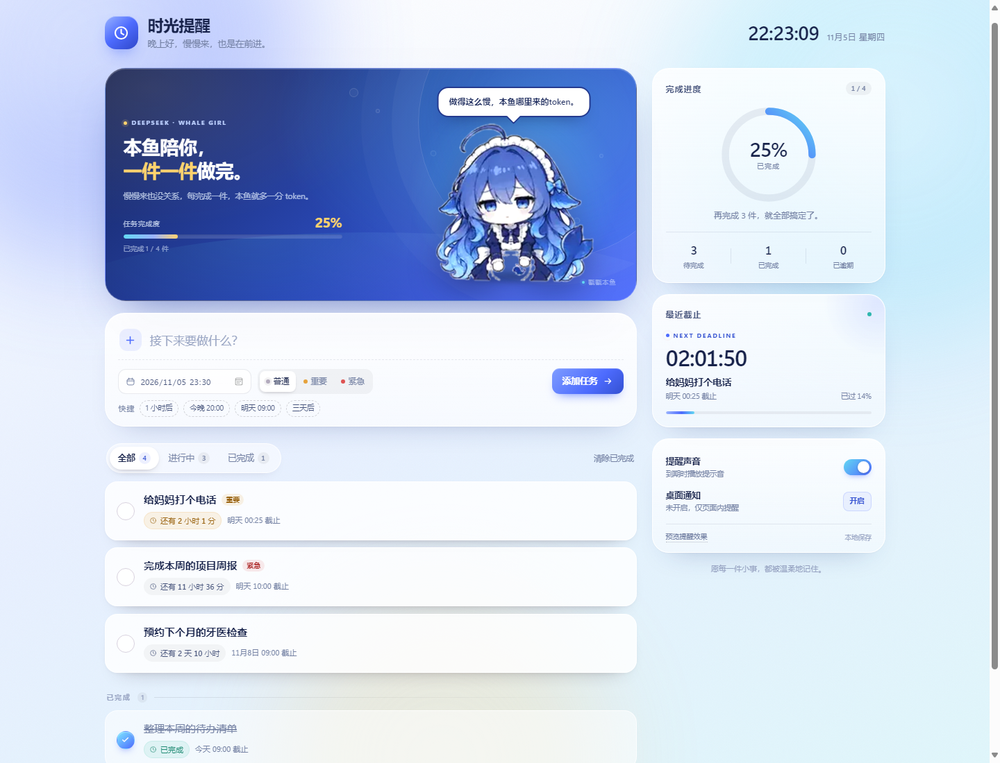
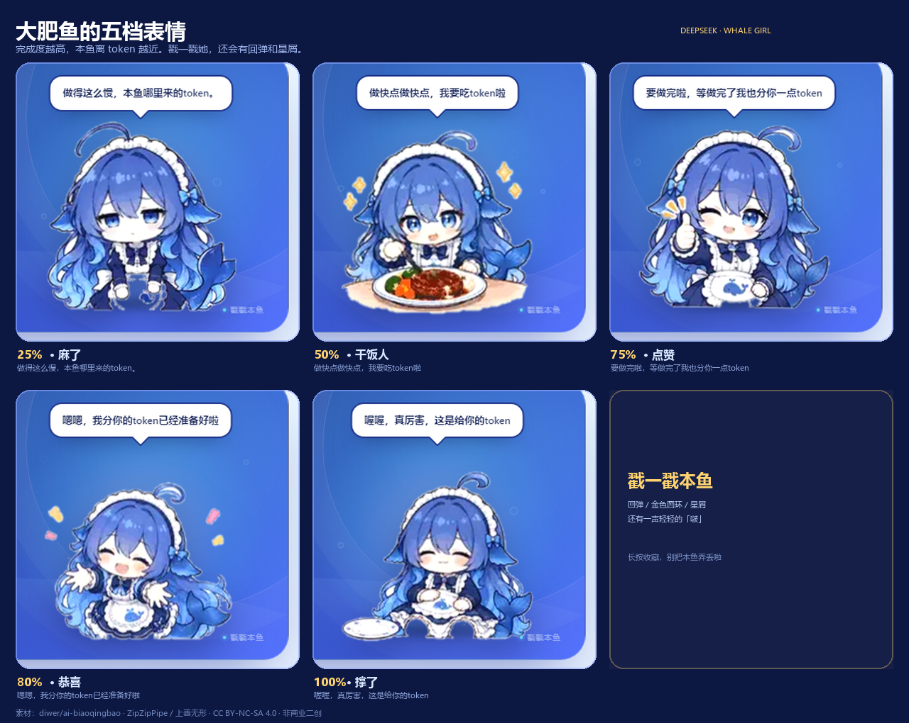

# 时光提醒 · Reminder

一个不需要安装、不需要联网的本地待办提醒页。把任务写下来，选好截止时间，时间一到它会在页面中央提醒你；还有一只蓝色大肥鱼陪你一起盯着进度。



## 打开方式

在浏览器地址栏输入：

```text
http://localhost:8000
```

本地服务已经启动好，打开这个网址就能直接使用。

桌面上的「时光提醒」快捷方式也已经准备好，双击它就会自动启动服务并打开浏览器。所有文件都整理在：

```text
C:\Users\86131\Desktop\时光提醒
```

如果以后这个网址打不开了，双击文件夹里的 `start-reminder.bat`，它会自动启动本地服务并打开浏览器。也可以在网页文件夹里手动启动：

```powershell
python -m http.server 8000
```

然后访问 `http://localhost:8000`。

> 直接双击 `index.html` 也能使用，但通过 `http://localhost:8000` 打开时，桌面通知的支持会更稳定。
> 桌面通知需要浏览器授权；即使不授权，页面内的提醒弹窗和提示音仍然有效。
> 浏览器标签页需要保持打开（可以切到后台），完全关闭浏览器后无法继续提醒。

## 功能

- **添加任务**：写内容、选截止时间、标记普通 / 重要 / 紧急，按 Enter 或点“添加任务”。
- **勾选完成**：点击左侧圆圈，任务会带着划线动画移动到“已完成”区域；全部完成时会撒彩纸。
- **截止倒计时**：列表和“最近截止”卡片会实时显示剩余时间，临近截止会变成琥珀色，逾期会变成红色。
- **到点提醒**：截止时间到达时弹出提醒，可“标记完成”“5 分钟后再提醒”或“稍后处理”；弹窗带提示音、桌面通知（授权后）和标签页标题闪烁。
- **编辑与撤销**：悬停任务可编辑标题 / 时间 / 优先级；删除和清除已完成都支持在 Toast 里撤销。
- **视图筛选**：全部 / 进行中 / 已完成，切换时有平滑的滑块和列表动画。
- **本地保存**：任务和声音设置保存在浏览器 `localStorage` 里，刷新不会丢。
- **预览提醒**：设置卡片底部的“预览提醒效果”可以随时查看提醒弹窗和声音。

## 大肥鱼陪伴

页面顶部住着一只蓝色大肥鱼——拟人化的鲸鱼娘：蓝色长发、鲸鱼尾巴、白蓝配色的女仆装，还有白色荷叶边头饰和一枚蓝色蝴蝶结。表情素材来自公开的 DeepSeek 娘（鲸鱼娘）二创表情包，去背景和裁切后放在 `whale/` 文件夹里。

- 点击鲸鱼娘：会播放挤压回弹的缩放动画、金色圆环和星屑，并有一声轻轻的“啵”。
- 她的表情和头顶的漫画气泡会随着完成进度实时变化，并带有原素材的小幅眨眼 / 动作动画。

| 完成进度 | 大肥鱼表情 | 气泡内容 |
| --- | --- | --- |
| 0% – 25% | 麻了、忧郁 | 做得这么慢，本鱼哪里来的token。 |
| 25% – 50% | 干饭人、盯着饭碗 | 做快点做快点，我要吃token啦 |
| 50% – 75% | 点赞、眯眼笑 | 要做完啦，等做完了我也分你一点token |
| 75% – 100% | 恭喜、超开心 | 嗯嗯，我分你的token已经准备好啦 |
| 100% | 撑了、捧着饭碗 | 喔喔，真厉害，这是给你的token |



## 小细节

- 首次打开会放入 4 条示例任务，可直接修改或删除。
- 点击“1 小时后 / 今晚 20:00 / 明天 09:00 / 三天后”可以快速填入截止时间。
- 编辑任务时按 `Esc` 取消。
- 提醒弹窗按 `Esc` 关闭。
- 页面支持 `prefers-reduced-motion`，系统开启“减少动态效果”时会自动收敛动画。

## 文件结构

```text
C:\Users\86131\Desktop\时光提醒\
├── index.html          页面结构
├── styles.css          视觉、布局与动画
├── app.js              任务逻辑、倒计时、提醒、音效、彩纸
├── start-reminder.bat  一键启动本地服务并打开浏览器
├── whale/              五档鲸鱼娘表情（webp）与素材 NOTICE
├── whale-icon.ico      鲸鱼娘快捷方式图标
├── preview-desktop.png 默认界面预览
├── preview-100.png     全部完成时的预览
├── preview-moods.png   五档表情速览
└── README.md
```

## 素材与许可

鲸鱼娘表情素材来自 **diwer/ai-biaoqingbao** 的“大肥鱼表情包”，角色设计：**ZipZipPipe / 上善无形**，素材许可为 **CC BY-NC-SA 4.0**（署名—非商业—相同方式共享）。本页面属于非商业二创，素材经过背景抠除、裁切、底部对齐和动画重排；`whale/` 中的图片同样是 CC BY-NC-SA 4.0 的修改版本，请勿用于商业用途。

- 素材仓库：<https://github.com/diwer/ai-biaoqingbao>
- 本页素材索引与打包参考：<https://github.com/kabarryo/dsh-fatfish>
- 许可协议：<https://creativecommons.org/licenses/by-nc-sa/4.0/>
- 本页图片的具体修改说明见 `whale/NOTICE.txt`。

数据只保存在当前浏览器，不会上传到任何地方。
